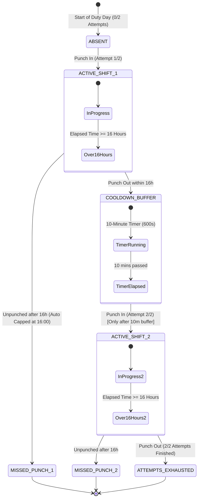

# Field Officer Attendance System: Mobile App & Web Integration Specification

This document summarizes the **Field Officer Attendance Lifecycle Rules**, client-side enforcement requirements for the **Mobile App**, backend synchronization with the database, and how these records are audited in the **Area Manager Web Portal**.

---

## 1. Executive Summary & Core Rules

| Rule | Description | Enforced By | Displayed In Area Manager Web |
| :--- | :--- | :--- | :--- |
| **1. 16-Hour Auto-Out & Missed Punch** | If an officer punches in and does not punch out within **16 hours**, the shift is automatically closed and recorded as a **Missed Punch**. Working hours are capped at **16:00**. | **Mobile App & Backend / Web** | Status badge: `Missed`<br>Punch Out: `Missed`<br>Working Hours: `16:00 (Capped 16h)` |
| **2. Max 2 Punch Attempts per 16h** | An officer is allowed at most **2 punch-in attempts** in a 16-hour duty window / shift cycle. The 3rd attempt is blocked. | **Mobile App (Enforce block)**<br>**Backend (API validation)** | Attempts column: `0/2`, `1/2 Used`, or `2/2 (Max)` |
| **3. 10-Minute Cooldown Buffer** | After punching out within the 16h window, the officer **must wait 10 minutes** before punching in again for Attempt #2. | **Mobile App (Lock button + countdown timer)** | Officer tag: `⏳ Cooldown (~Xm)` |

---

## 2. Attendance State Machine



---

## 3. Mobile App Client Responsibilities (Checklist for Mobile Developer)

### A. Punch In Button Logic
1. **Attempt Check**:
   - Before enabling the **"Punch In"** button, check the officer's punch count for the current 16h cycle.
   - If `attempts >= 2`:
     - Disable the Punch In button.
     - Display banner: *"Maximum 2 punch-in attempts reached for this duty cycle."*
2. **10-Minute Cooldown Buffer Check**:
   - If the officer punched out recently and `(Current Time - Last Punch Out Time) < 10 minutes`:
     - Disable the Punch In button.
     - Show an active countdown timer on the screen:
       > *"Please wait 06:42 before punching in again (10-minute cooldown active)."*
     - Re-enable the button once the 10-minute buffer expires.

### B. Punch Out Button & 16-Hour Auto-Out Logic
1. **Normal Punch Out**:
   - When the officer taps "Punch Out", send `out_time = now()`.
   - Start the 10-minute cooldown timer locally for attempt #2.
2. **Missed Punch Detection**:
   - If the app is opened or a background sync occurs and `(Current Time - Punch In Time) >= 16 hours`:
     - Transition the officer's state from `ACTIVE` to `MISSED_PUNCH`.
     - Do not allow a normal late punch-out for that expired shift.
     - Record `status: "MISSED_PUNCH"`.

---

## 4. Backend Database Schema & API Contract

### Database Tables:
- **`ATTENDANCE_TIME_LOG`**:
  - `oid`: Primary Key
  - `ATTENDANCE_CELL`: Foreign Key to `ATTENDANCE_CELL.oid`
  - `in_time`: Timestamp of punch in (e.g., `2026-09-03 13:35:56`)
  - `out_time`: Timestamp of punch out (`NULL` while shift is active)
- **Attempt Counting**:
  - `COUNT(atl.oid)` for the employee and date determines attempts: `0`, `1`, or `2`.

### API Response Format (`GET /api/v1/attendance`):
```json
{
  "data": {
    "summary": {
      "present": 3,
      "absent": 2,
      "missed_punch": 1,
      "total_officers": 6
    },
    "records": [
      {
        "employee_oid": 10213,
        "employee_name": "Anil Bhosale",
        "emp_code": "EMP006",
        "attendance_date": "2026-09-03",
        "punch_in": "13:35",
        "punch_out": "Missed Punch",
        "working_hours": "16:00",
        "status": "MISSED_PUNCH",
        "punch_in_attempts": 1,
        "max_attempts": 2,
        "attempts_exhausted": false,
        "is_missed_punch": true,
        "in_buffer": false,
        "buffer_remaining_seconds": 0
      },
      {
        "employee_oid": 10212,
        "employee_name": "Sumit Pardeshi",
        "emp_code": "EMP005",
        "attendance_date": "2026-09-03",
        "punch_in": "11:58",
        "punch_out": "13:14",
        "working_hours": "01:15",
        "status": "PRESENT",
        "punch_in_attempts": 2,
        "max_attempts": 2,
        "attempts_exhausted": true,
        "is_missed_punch": false,
        "in_buffer": false,
        "buffer_remaining_seconds": 0
      }
    ]
  }
}
```

---

## 5. Area Manager Web Portal Upgrades

1. **Summary KPI Cards**:
   - Four distinct KPI status cards:
     - 🟢 **Present**: Active shifts (<16h) or completed shifts.
     - 🟠 **Missed Punch**: Officers unpunched past 16 hours.
     - 🔴 **Absent**: Officers with 0 punch logs.
     - 🔵 **Total Officers**: Total active field staff.
2. **Status Filter Dropdown**:
   - Area Managers can filter by: `All Status`, `Present`, `Missed Punch`, and `Absent`.
3. **Table Columns**:
   - **Attempts (16h)**: Displays `0/2`, `1/2`, or `2/2 (Max)`.
   - **Working Hours**: Automatically capped at `16:00` for missed punches, eliminating runaway timers (e.g. 21+ hours).
   - **Buffer Cooldown**: Displays `⏳ Cooldown (~Xm)` if an officer punched out within the last 10 minutes.

---

## 6. Verification & Test Scenarios

| Scenario | Input Condition | Expected Result in App & Web |
| :--- | :--- | :--- |
| **A. Normal Shift** | Punch in at 09:00, punch out at 17:00 | Status: `PRESENT`, Hours: `08:00`, Attempts: `1/2`. |
| **B. Cooldown Buffer** | Punched out 4 minutes ago, attempt #1 | App: Punch-in disabled with 6m countdown.<br>Web: `⏳ Cooldown (6m)`. |
| **C. Second Shift** | Punched in after 10m buffer, punched out after 3 hours | Status: `PRESENT`, Attempts: `2/2 (Max)`. Further punch-ins locked. |
| **D. Missed Punch (>16h)** | Punched in at 13:35 yesterday, no punch-out | Status: `MISSED_PUNCH`, Punch Out: `Missed Punch`, Hours: `16:00 (Capped)`. |
